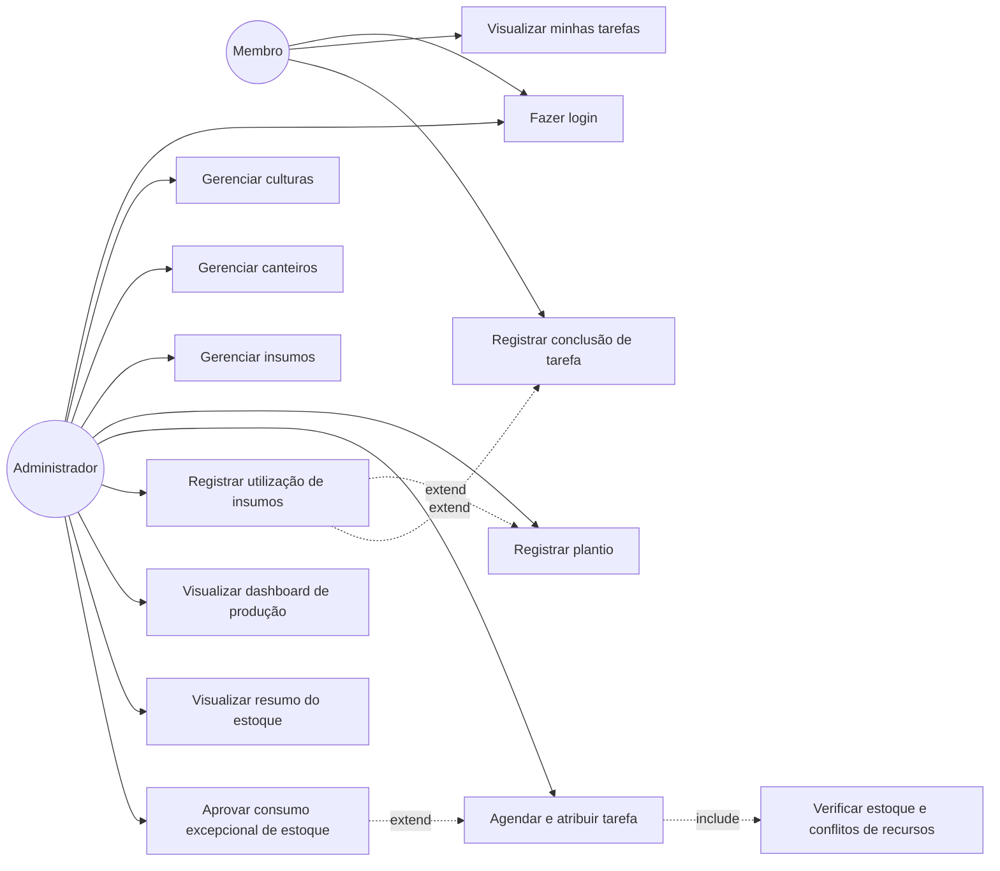
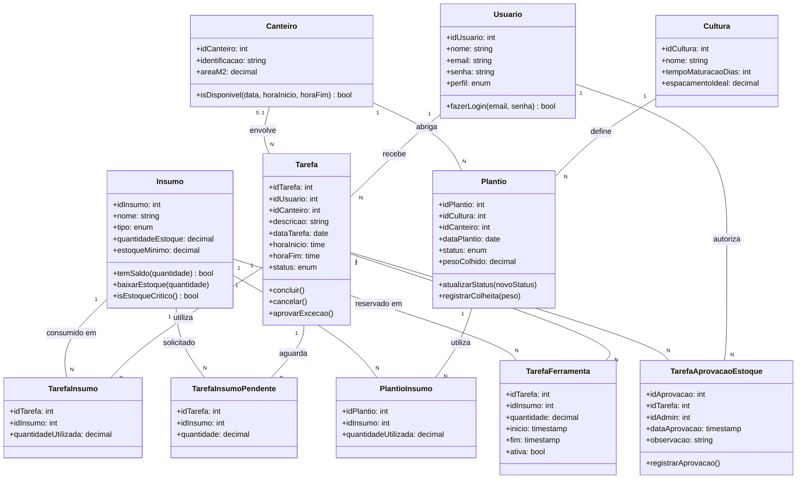

# Diagramas UML — Horta Familiar

## 1. Diagrama de Casos de Uso

## 2. Diagrama de Classes

## 3. Rastreabilidade — caso de uso → história do backlog

| Caso de uso | História(s) relacionada(s) (E2) |
|---|---|
| Fazer login | #1 |
| Gerenciar culturas | #2 |
| Gerenciar canteiros | #3 |
| Gerenciar insumos | #4 |
| Registrar plantio | #5 |
| Agendar e atribuir tarefa | #6 |
| Visualizar minhas tarefas | #7 |
| Registrar conclusão de tarefa | #8 |
| Registrar utilização de insumos e atualizar estoque | #9 |
| Verificar estoque e gerar alerta de estoque mínimo | #10 |
| Detectar conflitos de recursos e agendamento | #11 |
| Visualizar dashboard de produção | #12 |
| Visualizar resumo do estoque | #13 |
| Aprovar consumo excepcional de estoque | #14 |

## 4. Regras de negócio representadas

- O acesso às funcionalidades administrativas depende do perfil ADMIN.
- O estoque é atualizado automaticamente quando ocorre o registro de consumo de insumos.
- O sistema identifica insumos com quantidade igual ou inferior ao estoque mínimo.
- O agendamento de tarefas verifica conflitos de utilização de canteiros e ferramentas.
- Quando uma tarefa exige quantidade superior ao estoque disponível, ela pode permanecer em `AGUARDANDO_APROVACAO`.
- Os insumos pendentes não provocam baixa no estoque antes da aprovação.
- A aprovação excepcional é exclusiva do administrador e fica registrada no banco de dados.
- Após a aprovação, o consumo é efetivado e a tarefa retorna ao status `PENDENTE`.